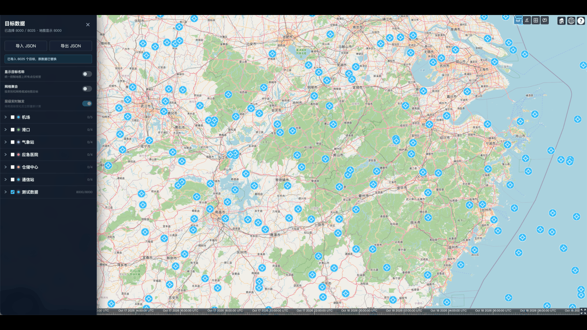
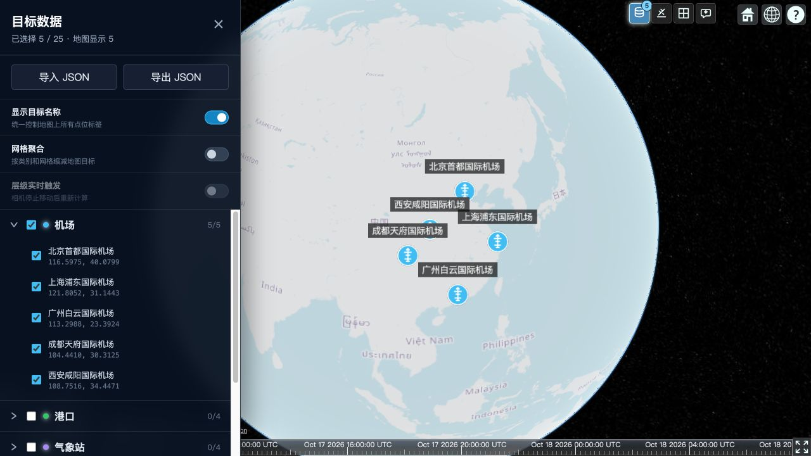
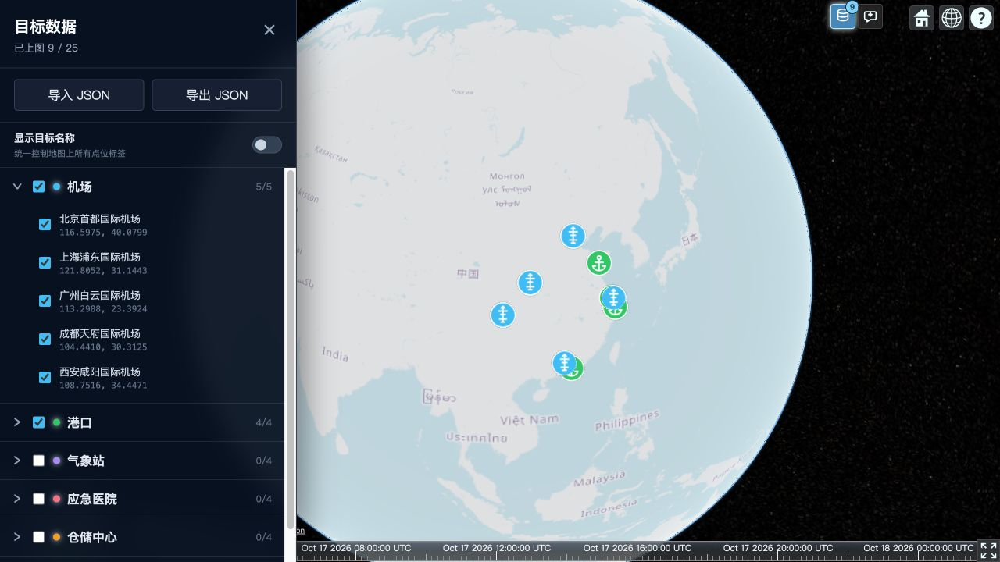
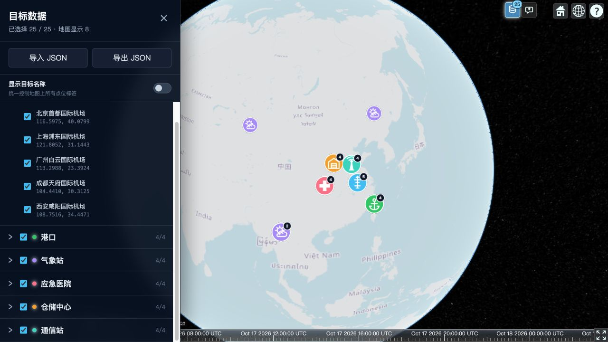
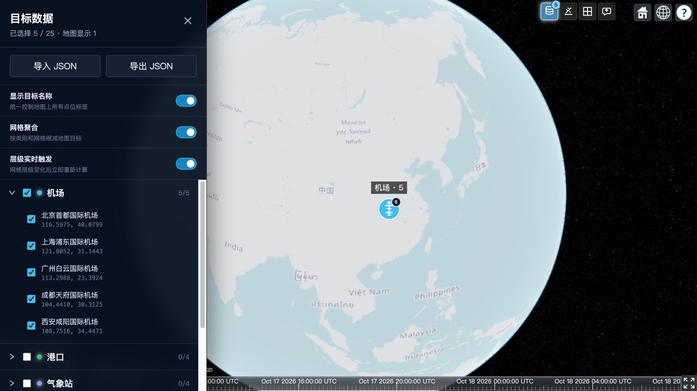
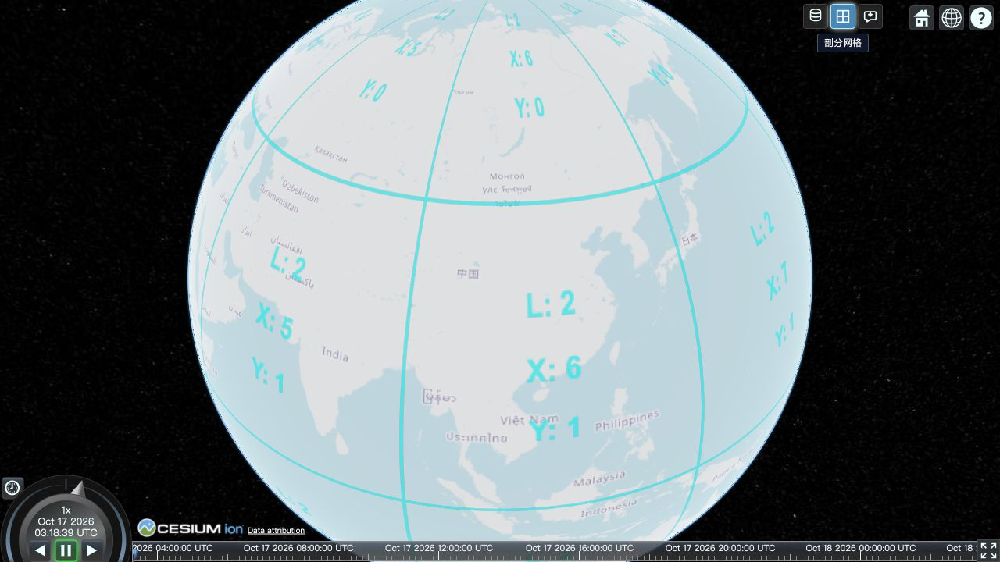
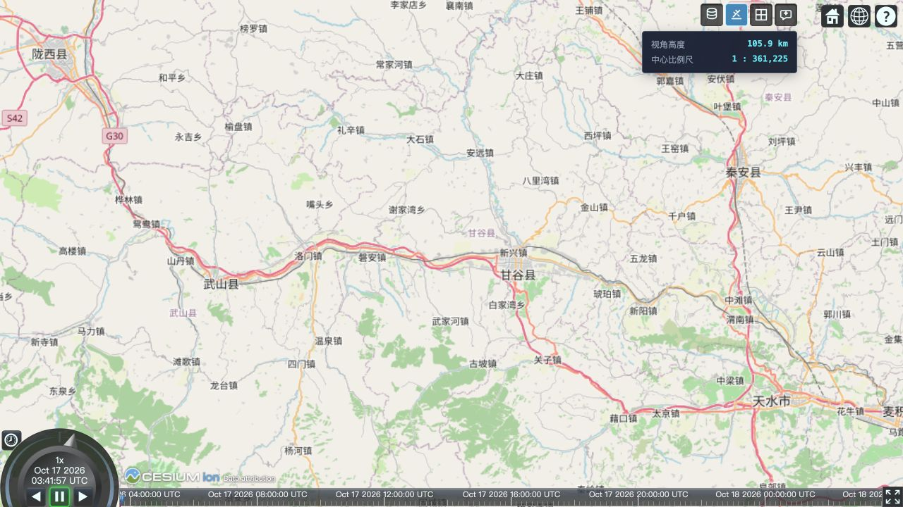

# 性能优化亮点 - 网格聚合解聚



# 当前功能总结

当前项目已经形成一个 React + Cesium 的目标态势展示原型，包含目标管理、分类图标、网格聚合、剖分可视化、实时视角信息和智能助手等功能。

## 1. Cesium 地图基础框架

实现效果：

- 使用 React 挂载 Cesium `Viewer`。
- 使用 OpenStreetMap 作为底图。
- 保留 Cesium 自带的 Home、2D/3D、帮助、时间轴和全屏控件。
- 右上角扩展了目标数据、视角信息、剖分网格、智能助手四个按钮。
- 组件卸载时销毁 Viewer，避免重复创建和内存泄漏。

启动路径：

```text
npm run dev
    ↓
Vite 启动开发服务器
    ↓
index.html
    ↓
src/main.jsx
    ↓
<App />
    ↓
创建 Cesium Viewer
    ↓
加载地图和各业务组件
```

主要代码：

- [React 入口](</Users/allen/Documents/ChatGPT/myCesuimDemo 2/src/main.jsx:1>)
- [Cesium Viewer 初始化](</Users/allen/Documents/ChatGPT/myCesuimDemo 2/src/App.jsx:101>)
- [右上角工具按钮](</Users/allen/Documents/ChatGPT/myCesuimDemo 2/src/components/MapToolButtons.jsx:37>)

---

## 2. 目标数据管理

实现效果：

- 左侧目标数据窗口按类别管理目标。
- 支持类别展开、单点勾选、类别全选和取消全选。
- 当前模拟数据包含机场、港口、气象站、应急医院、仓储中心和通信站。
- 顶部显示“已选择数量”和“地图实际显示数量”。
- 支持 JSON 导入、导出。
- 导入时校验必要字段、经纬度范围和重复 ID。
- 导入新数据会替换现有数据并清空当前选择。



实现思路：

- `StaticTarget` 统一定义静态目标的数据结构。
- `selectedIds` 使用 `Set` 保存当前选中的目标 ID。
- 面板通过 `categoryId` 对目标进行分组。
- 导出时将对象转成 JSON，通过 `Blob` 生成下载文件。
- 导入时调用 `StaticTarget.fromJSON()` 做数据校验。

主要代码：

- [目标数据面板](</Users/allen/Documents/ChatGPT/myCesuimDemo 2/src/components/TargetPanel.jsx:82>)
- [静态目标类](</Users/allen/Documents/ChatGPT/myCesuimDemo 2/src/models/StaticTarget.js:1>)
- [模拟目标数据](</Users/allen/Documents/ChatGPT/myCesuimDemo 2/src/data/mockTargets.js:1>)
- [导入导出逻辑](</Users/allen/Documents/ChatGPT/myCesuimDemo 2/src/App.jsx:299>)

---

## 3. 分类图标与名称控制

实现效果：

- 目标不再显示为普通圆点，而是使用分类图标。
- 已定义机场、飞机、港口、气象站、医院、仓库、通信站和默认图标。
- 图标颜色来自目标的 `color` 字段。
- “显示目标名称”开关统一控制所有地图标签。
- 隐藏名称后只保留图标，减少文字遮挡。



实现思路：

- 使用 Cesium `Billboard` 代替 `Point`。
- 分类图标由内嵌 SVG 生成，无需维护额外图片资源。
- SVG 转成 `data:image/svg+xml` 后交给 Billboard。
- 使用缓存避免相同类别、颜色和数量重复生成 SVG。
- 标签使用 Cesium `Label`，通过 `showTargetNames` 控制显示。

主要代码：

- [分类图标生成](</Users/allen/Documents/ChatGPT/myCesuimDemo 2/src/utils/targetIcons.js:1>)
- [Billboard 和 Label 渲染](</Users/allen/Documents/ChatGPT/myCesuimDemo 2/src/App.jsx:178>)
- [名称显示开关](</Users/allen/Documents/ChatGPT/myCesuimDemo 2/src/components/TargetPanel.jsx:176>)

---

## 4. 网格分类聚合

实现效果：

- 高空视角下，同一类别、同一网格内的目标合并成一个聚合根节点。
- 不同类别永远不会混合聚合。
- 聚合图标右上角显示所包含的目标数量。
- 聚合位置取该网格内所有目标经纬度和高度的平均值。
- 不同类别的聚合中心过近时，进行少量屏幕偏移，防止图标互相遮挡。
- 当前 25 个目标在初始高空视角下缩减为 8 个地图实体。



实现思路：

1. 根据相机高度从 `heightLevels` 找到聚合层级。
2. 使用 Cesium `GeographicTilingScheme.positionToTileXY()` 计算目标所属网格。
3. 使用以下组合键分组：

```text
categoryId + tileX + tileY
```

4. 一个组只有一个目标时保留原目标。
5. 一个组包含多个目标时生成聚合根节点。
6. 视角降低到 100 公里以下时，`level` 变成 `null`，恢复原始目标。

当前层级配置位于：

- [网格层级与聚合算法](</Users/allen/Documents/ChatGPT/myCesuimDemo 2/src/utils/targetGrid.js:5>)

---

## 5. 聚合、解聚与刷新模式控制

### 网格聚合开关

打开时：

- 按类别和网格生成聚合根节点。
- 5 个机场在初始高空视角下显示为 1 个聚合节点。

关闭时：

- 立即删除所有聚合根节点。
- 恢复全部原始目标。
- 5 个机场重新显示为 5 个独立图标。

### 层级实时触发开关

关闭状态：

- 监听 `camera.moveEnd`。
- 相机停止移动后重新计算网格层级。
- 适合数据量较大、优先考虑性能的情况。

开启状态：

- 在 Cesium `preRender` 阶段检查网格层级。
- 一旦高度跨越 `heightLevels` 阈值，立即重新聚合或解聚。
- 网格层级没有变化时不会更新 React 状态。



聚合关闭时，“层级实时触发”会自动禁用：


实际验证：

```text
选择机场：5 个
默认聚合：地图显示 1
关闭聚合：地图显示 5
重新聚合：地图显示 1
开启实时层级触发并降低高度：地图显示 5
```

主要代码：

- [聚合状态和刷新方式监听](</Users/allen/Documents/ChatGPT/myCesuimDemo 2/src/App.jsx:76>)
- [聚合控制界面](</Users/allen/Documents/ChatGPT/myCesuimDemo 2/src/components/TargetPanel.jsx:191>)

---

## 6. Cesium 官方剖分网格

实现效果：

- 右上角“剖分网格”按钮控制网格显示。
- 开启后显示 Cesium 当前渲染瓦片的边界。
- 每个网格内部显示 `Level / X / Y`。
- 再次点击会移除网格图层。



实现思路：

- 使用 Cesium 官方 `TileCoordinatesImageryProvider`。
- 开启时通过 `imageryLayers.addImageryProvider()` 添加到地图。
- 关闭时通过 `imageryLayers.remove()` 删除。
- 没有自行绘制经纬度线或 Primitive。

主要代码：

- [官方网格图层开关](</Users/allen/Documents/ChatGPT/myCesuimDemo 2/src/App.jsx:278>)
- [剖分网格按钮](</Users/allen/Documents/ChatGPT/myCesuimDemo 2/src/components/MapToolButtons.jsx:73>)

---

## 7. 实时视角高度和比例尺

实现效果：

- 右上角“视角信息”按钮控制信息面板。
- 显示当前相机椭球高度。
- 显示屏幕中心附近的近似比例尺。
- 缩放、旋转和倾斜地图时实时更新。



实现思路：

- 高度直接读取：

```js
viewer.camera.positionCartographic.height
```

- 从屏幕中心左右各取一个点，使用 `camera.getPickRay()` 投射到地球表面。
- 将两个交点转换为 `Cartographic`。
- 使用 `EllipsoidGeodesic` 计算地表距离。
- 根据像素距离和 96 DPI 换算为近似 `1 : n` 比例尺。
- 相机变化事件最多每 100ms 更新一次。

比例尺是屏幕中心附近的近似值，会受相机倾斜角、视角和浏览器显示密度影响。

主要代码：

- [高度与比例尺计算](</Users/allen/Documents/ChatGPT/myCesuimDemo 2/src/App.jsx:31>)
- [实时更新监听](</Users/allen/Documents/ChatGPT/myCesuimDemo 2/src/App.jsx:149>)
- [信息面板](</Users/allen/Documents/ChatGPT/myCesuimDemo 2/src/App.jsx:438>)

---

## 8. 智能助手与软件控制

实现效果：

智能助手有两种模式：

- 本地控制
- DeepSeek 流式问答和工具调用

本地控制目前支持：

- 打开、关闭目标数据窗口。
- 显示全部目标。
- 显示或隐藏指定类别。
- 清空地图目标。
- 查询目标数量和分类统计。
- 右上角“操作状态”按钮控制右下角半透明状态面板。
- 勾选、取消勾选、聚合切换、名称显示和数据导入导出等操作会记录在状态面板中。
- 状态面板固定高度，消息左侧显示日期时间，时间为蓝色、状态文字为白色；即使没有消息，打开按钮也会显示空面板。

例如输入“显示全部机场”后，助手会修改地图选择状态，并回复执行结果。


实现思路：

```text
用户输入
   ↓
本地规则识别
   ↓
生成 actions
   ↓
App 对 action 做白名单检查
   ↓
修改 selectedIds 或面板状态
   ↓
Cesium 地图自动更新
```

当前动作白名单包括：

```text
open-target-panel
close-target-panel
clear-all-targets
select-all-targets
select-category
deselect-category
```

DeepSeek 模式同样支持地图操作。前端会把当前类别 ID 和名称传给 Python 后端，后端通过 DeepSeek Chat Completions 的 `tools` 参数声明地图工具。模型识别到“显示所有的机场”后，会在 SSE 流中返回类似下面的工具调用：

```json
{
  "name": "select_category",
  "arguments": {
    "categoryId": "airport"
  }
}
```

前端只接受白名单中的工具名，并将下划线格式映射为已有的界面 Action，例如 `select_category` 映射为 `select-category`，随后勾选所有 `categoryId === "airport"` 的目标。模型不能直接执行 JavaScript，也不能操作白名单之外的状态。

主要代码：

- [智能助手窗口](</Users/allen/Documents/ChatGPT/myCesuimDemo 2/src/components/AssistantPanel.jsx:13>)
- [本地意图识别](</Users/allen/Documents/ChatGPT/myCesuimDemo 2/src/services/assistantService.js:4>)
- [动作白名单与执行](</Users/allen/Documents/ChatGPT/myCesuimDemo 2/src/App.jsx:344>)
- [操作状态面板](</Users/allen/Documents/ChatGPT/myCesuimDemo 2/src/App.jsx:469>)

---

## 9. DeepSeek SSE 流式问答、Markdown 和 Function Call

实现效果：

- 目标分析类问题由前端编排三个阶段：LLM 前置分析、业务数据查询、LLM 总结分析。
- 前端通过 `POST /chat` 请求 Python 服务。
- 前端与 Python 后端使用 SSE 流式读取。
- Python 后端与 DeepSeek 同样使用流式请求。
- 每收到一段增量内容，就更新当前助手气泡。
- 工具调用参数也按 SSE 增量分片接收，前端拼接完整 JSON 后再校验和执行。
- 阶段二不再请求后端查询接口；前端直接使用当前 `targets` 状态筛选真实目标并渲染表格，不让 LLM 生成经纬度。
- “显示所有的机场”等指令会调用 `select_category`，而不是再次依赖前端正则匹配。
- 所有用户和助手气泡均支持 Markdown。
- 支持标题、列表、粗体、代码块和换行。
- Markdown 转 HTML 后通过 DOMPurify 清理，降低 XSS 风险。

实现链路：

```text
AssistantPanel
    ↓ 阶段一：fetch POST /chat（analysis）
前置分析文本 + query_targets 工具参数
    ↓ 阶段二：前端 queryTargetsFromLocalData()
真实目标结构化数据
    ↓ 前端生成表格并计算统计结果
    ↓ 阶段三：fetch POST /chat（summary）
总结文本 SSE
    ↓
消息 blocks：text → table → text

assistantService.streamDeepSeek()
    ↓
FastAPI
    ├─ httpx.stream() → DeepSeek API
    └─ 透传 query_targets 查询意图，不读取目标数据
    ↓
React 使用当前 targets 状态筛选数据，累加 Markdown、工具参数和结构化表格
```

主要代码：

- [前端 SSE 读取](</Users/allen/Documents/ChatGPT/myCesuimDemo 2/src/services/assistantService.js:80>)
- [结构化目标表格](</Users/allen/Documents/ChatGPT/myCesuimDemo 2/src/components/TargetTable.jsx:1>)
- [前端目标查询函数](</Users/allen/Documents/ChatGPT/myCesuimDemo 2/src/App.jsx:124>)
- [Markdown 渲染](</Users/allen/Documents/ChatGPT/myCesuimDemo 2/src/components/MarkdownContent.jsx:1>)
- [Python SSE 代理](</Users/allen/Documents/ChatGPT/myCesuimDemo 2/demo/main_SSE_DeepSeek.py:1>)

Python 后端声明的地图工具包括：

```text
open_target_panel
close_target_panel
clear_all_targets
select_all_targets
select_category(categoryId)
deselect_category(categoryId)
query_targets(categoryId?)
```

DeepSeek 实际运行还需要：

```bash
export DEEPSEEK_KEY="你的密钥"
uvicorn demo.main_SSE_DeepSeek:app --reload --port 8000
```

如果部署到正式环境，建议将 Python 当前的全开放 CORS 改为明确的前端域名。

## 当前验证状态

- React/Vite 生产构建通过。
- 聚合 `5 → 1` 验证通过。
- 关闭聚合并解聚 `1 → 5` 验证通过。
- 层级实时触发跨阈值更新验证通过。
- 官方剖分网格开关验证通过。
- 高度和比例尺实时更新验证通过。
- 智能助手本地操作地图验证通过。
- DeepSeek 前后端 SSE、Markdown 和工具调用代码已接入；真实服务依赖有效的 `DEEPSEEK_KEY`、运行中的 Python 后端和可访问 DeepSeek API 的网络。
